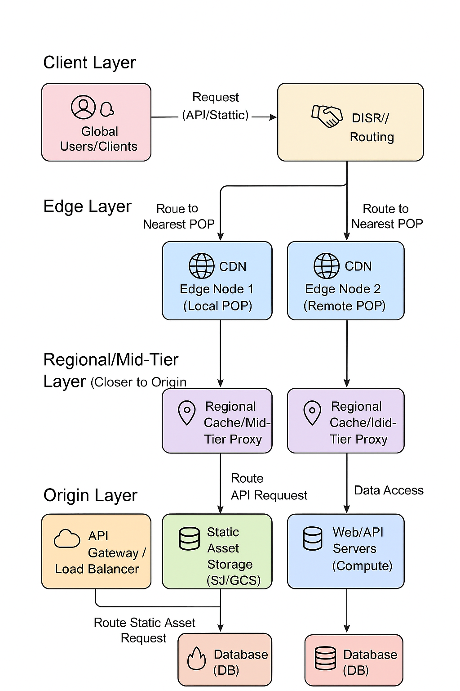

内容覆盖：多级缓存架构、CDN 策略、缓存键/变体、失效与删除、缓存一致性、缓存击穿/雪崩/穿透、预热/预取、缓存可观测性、安全性与认证、边缘计算与缓存、费用/容量管理等。

## 总体架构类（基础到进阶）

### 一、HTTP缓存总体流程

```markdown
1. 浏览器加载资源 → 检查 Service Worker
    ├─ 若 SW 拦截 → 使用 SW 策略返回资源
    └─ 否则进入浏览器缓存流程

2. 检查 Memory Cache
    ├─ 若存在且有效 → 直接返回（最快），停止流程
    └─ 否则检查 Disk Cache

3. 检查强缓存（Cache-Control/Expires）
    ├─ 若命中 → 直接返回本地缓存
    └─ 未命中 → 进入协商缓存

4. 检查 ETag / Last-Modified
    ├─ 有缓存标记 → 发条件请求
        ├─ 304 → 使用本地缓存
        └─ 200 → 使用新资源并更新缓存
    └─ 无缓存标记 → 直接下载新资源

5. 根据响应头决定是否写入缓存
    ├─ 写入 Memory Cache / Disk Cache
    └─ 或不缓存（no-store）

```

在 HTTP 缓存控制中，当涉及到浏览器向服务器发送`条件请求（Conditional Requests）`来验证资源是否过期时，`ETag` 和 `Last-Modified` 的优先级顺序是明确的。

-----

#### 🥇 优先级总结

**`ETag` 的优先级高于 `Last-Modified`。**

这意味着如果 HTTP 响应头中同时包含了 `ETag` 和 `Last-Modified`，浏览器在后续发起条件请求时，会优先使用基于 `ETag` 的机制。

#### 详细解释

1.  **服务器响应时（Set Cache）**
    服务器在返回资源内容时，通常会设置这两个头部：

    ```http
    HTTP/1.1 200 OK
    Last-Modified: Tue, 25 Nov 2025 08:00:00 GMT 
    ETag: "v1.2.3-1a2b3c4d5e" 
    Content-Length: 1024
    ```

2.  **浏览器再次请求时（Conditional Request）**
    当浏览器需要再次请求该资源时，它会将这两个值分别放入对应的条件请求头中：

      * `If-None-Match` (对应 `ETag`)
      * `If-Modified-Since` (对应 `Last-Modified`)

    浏览器发送的请求头会包含：

    ```http
    GET /style.css HTTP/1.1
    If-None-Match: "v1.2.3-1a2b3c4d5e" 
    If-Modified-Since: Tue, 25 Nov 2025 08:00:00 GMT
    ```

3.  **服务器处理时（Priority Check）**
    服务器接收到请求后，会首先检查 `If-None-Match`（即 `ETag`）。

      * **如果** `If-None-Match` 存在，服务器会忽略 `If-Modified-Since`，并仅根据 `ETag` 进行验证。
          * **匹配:** 返回 `304 Not Modified`。
          * **不匹配:** 返回 `200 OK` 及新的内容。
      * **如果** `If-None-Match` 不存在，服务器才会检查 `If-Modified-Since`（即 `Last-Modified`）。

#### 为什么 `ETag` 优先级更高？

`ETag`（Entity Tag，实体标签）的设计是为了弥补 `Last-Modified` 的不足，因此它的验证更精确、更可靠：

| 特性 | `Last-Modified` | `ETag` |
| :--- | :--- | :--- |
| **粒度** | **秒级**（可能不精确）| **精确到字节内容**（通过哈希计算）|
| **时钟要求** | 依赖服务器和客户端的**时钟同步**，可能因时区或本地时钟问题造成错误。 | 仅依赖内容的哈希值，**不依赖时间**。 |
| **内容变动** | 如果文件被修改后，又被还原到修改前的内容，时间戳会变化，导致验证失败。| 只要内容不变，`ETag` 就不变，验证会成功。|
| **周期性生成**| 如果资源是周期性生成的，但内容没有变化，时间戳也会变化，浪费带宽。| 内容不变，`ETag` 不变，返回 `304`。|

因此，`ETag` 提供的**强验证**（Strong Validation）比 `Last-Modified` 提供的**弱验证**（Weak Validation）更可靠，自然拥有更高的优先级。

-----


下面整理一份**通俗但专业**、适合面试回答的 **HTTP 缓存机制总结**（面试版 + 工作实践版）。

---

### 二、强缓存（Strong Cache）

#### 👉 特点

* **不与服务器通信，直接从本地缓存读取**
* 性能最好

#### 👉 关键响应头

##### (1) `Expires`

* HTTP/1.0
* 一个绝对时间，例如：

  ```
  Expires: Wed, 21 Oct 2025 07:28:00 GMT
  ```
* 缺点：受客户端时间影响（如果用户修改系统时间，可能失效）

##### (2) `Cache-Control`

* HTTP/1.1
* 更推荐用
* 常用值：

| 指令             | 说明                 |
| -------------- | ------------------ |
| `max-age=3600` | 缓存 3600 秒          |
| `public`       | 所有对象（包括 CDN）都可缓存   |
| `private`      | 仅浏览器可缓存            |
| `no-cache`     | **不是不缓存**，而是必须协商验证 |
| `no-store`     | 完全不缓存              |

示例：

```
Cache-Control: public, max-age=3600
```

---

### 三、协商缓存（Negotiated Cache）

#### 👉 特点

* 浏览器需要向服务器确认缓存是否可继续使用
* 如果资源没变：返回 **304 Not Modified**，继续用本地缓存
* 有变：返回 **200 OK + 新资源**

#### 👉 关键请求/响应头

---

#### (1) `Last-Modified` / `If-Modified-Since`

* 服务器返回资源最后修改时间：

  ```
  Last-Modified: Wed, 21 Oct 2025 07:28:00 GMT
  ```
* 浏览器下次请求带上：

  ```
  If-Modified-Since: Wed, 21 Oct 2025 07:28:00 GMT
  ```
* 缺点：

  * 精度只有秒
  * 文件频繁改动但内容未变 → 会导致不必要的更新

---

#### (2) `ETag` / `If-None-Match`

* ETag 是资源的**唯一标识（哈希值）**
* 内容不变 → ETag 不变

示例：

```
ETag: "abc123"
```

浏览器下次请求：

```
If-None-Match: "abc123"
```

⚠️ 注意：**ETag 优先级高于 Last-Modified**

---

### 四、强缓存 vs 协商缓存总结

| 缓存类型 | 是否访问服务器   | 状态码                   | 优点           | 缺点        |
| ---- | --------- | --------------------- | ------------ | --------- |
| 强缓存  | ❌ 不访问服务器  | 200（from disk/memory） | 性能最好         | 需要设置好过期策略 |
| 协商缓存 | ✔️ 会访问服务器 | 304                   | 避免内容变化时误用旧缓存 | 仍有网络开销    |

---

### 五、不同缓存命中示例（浏览器 Network 面板）

| 缓存类型         | Network 显示         |
| ------------ | ------------------ |
| memory cache | from memory cache  |
| disk cache   | from disk cache    |
| 强缓存命中        | 200 OK（from cache） |
| 协商缓存命中       | 304 Not Modified   |

---

### 六、前端常见缓存策略（面试常问）

#### 🎯 1. 静态资源（JS/CSS/图片）

**方案：长缓存 + 文件名 hash**

```
Cache-Control: max-age=31536000, immutable
```

* 构建时加 hash，如：`app.8a2c3.js`
* 文件更新 → hash 变化 → 浏览器重新下载

---

#### 🎯 2. HTML 资源

**不要长期缓存**

```
Cache-Control: no-cache
```

因为 HTML 要立即反映更新

---

#### 🎯 3. 接口数据

可按需：

* GET 可缓存：`Cache-Control: max-age=30`
* POST 一般不缓存

---

### 七、浏览器缓存位置（加分点）

| 缓存位置                 | 特点               |
| -------------------- | ---------------- |
| Memory Cache         | 优先级高，页面关闭后清空     |
| Disk Cache           | 持久化，容量大          |
| Service Worker Cache | 自由控制缓存逻辑（PWA）    |
| IndexDB/LocalStorage | 手动存储，不属于 HTTP 缓存 |

---

### 八、面试回答模板

> HTTP 缓存分为强缓存和协商缓存。
> 强缓存通过 `Expires` 和 `Cache-Control` 实现，如果命中强缓存浏览器不会与服务器通信；
> 协商缓存通过 `Last-Modified/If-Modified-Since` 和 `ETag/If-None-Match` 实现，如果资源未变化服务器返回 304。
> 一般我们对静态资源使用长缓存，通过文件 hash 控制更新；对 HTML 使用 no-cache 来保证及时更新。

---


### Q1 — 设计一个全球分布的缓存体系来加速静态资源与 API，请画出高层架构并说明各层职责。

**答案要点**

* 层次：浏览器 cache (memory/disk) → Edge CDN (POPs) → Edge Workers / Edge Cache → Regional cache / Reverse proxy (Nginx/HAProxy + proxy_cache) → Origin / App servers → DB/Storage。
* 职责：

  * 浏览器：短期快速命中，减少往返。
  * CDN POP：地理就近服务、减少 TTFB、缓存静态与部分 API。
  * Edge Workers：实现认证、A/B、图像处理、stale strategies。
  * Regional cache：缓和对 origin 的压力，做更长的缓存与复杂 revalidation。
  * Origin：最终一致性数据、权限校验、动态渲染。
    **工程注意**
* 每层都需要日志/指标、统一 cache-key 规则、熔断与回源限流、热备和多活。

设计一个全球分布的缓存体系来加速静态资源和 API，需要一个多层次、分工明确的架构。这种架构通常结合了 CDN、边缘缓存和源站缓存，以实现低延迟和高可用性。

### 🗺️ 全球分布缓存体系高层架构

```mermaid
graph TD
    subgraph Client Layer
        A[🌎 Global Users/Clients]
        B[🤝 DNS/Routing]
    end

    subgraph Edge Layer (Closest to Users)
        C1[🌐 CDN Edge Node 1 (Local POP)]
        C2[🌐 CDN Edge Node 2 (Remote POP)]
    end

    subgraph Regional/Mid-Tier Layer (Closer to Origin)
        D1[📍 Regional Cache/Mid-Tier Proxy]
        D2[📍 Regional Cache/Mid-Tier Proxy]
    end

    subgraph Origin Layer (Source of Truth)
        E[☁️ API Gateway / Load Balancer]
        F[💻 Web/API Servers (Compute)]
        G[💾 Static Asset Storage (S3/GCS)]
        H[🔥 In-Memory Cache (Redis/Memcached)]
        I[🗄️ Database (DB)]
    end

    A -->|Request (API/Static)| B
    B -->|Route to Nearest POP| C1
    B -->|Route to Nearest POP| C2

    C1 -->|Cache Miss/Validation| D1
    C2 -->|Cache Miss/Validation| D2

    D1 -->|Cache Miss/Validation| E
    D2 -->|Cache Miss/Validation| E

    E -->|Route API Request| F
    E -->|Route Static Asset Request| G

    F -->|Data Access| H
    F -->|Data Access| I

    C1 <-.-> |Cache Refresh/Pre-fetch| G
    C2 <-.-> |Cache Refresh/Pre-fetch| G

    style A fill:#f9f,stroke:#333
    style C1 fill:#ccf,stroke:#333
    style C2 fill:#ccf,stroke:#333
    style D1 fill:#ddf,stroke:#333
    style D2 fill:#ddf,stroke:#333
    style E fill:#faa,stroke:#333
    style G fill:#afa,stroke:#333
    style H fill:#fcc,stroke:#333
```



-----

#### 📜 各层职责说明

##### 1. 客户端层 (Client Layer)

| 组件 | 职责 | 资源类型 |
| :--- | :--- | :--- |
| **Global Users/Clients** | 发起请求的终端用户、浏览器或移动应用。 | N/A |
| **DNS/Routing** | **全球流量调度入口。** 通过 DNS 服务（如 GeoDNS 或 Anycast IP），将用户请求路由到地理位置上最近的 CDN 边缘节点（POP）。 | N/A |

##### 2. 边缘缓存层 (Edge Layer - CDN)

这是加速体系的**第一道防线**，最靠近用户，用于处理大部分请求。

| 组件 | 职责 | 资源类型 |
| :--- | :--- | :--- |
| **CDN Edge Node (POP)** | **终结用户连接，快速响应。** | |
| **静态资源** | 缓存 **`Cache-Control: public`** 的资源（JS, CSS, 图片, 视频等）。命中率目标高达 95%+。| 静态资源 |
| **API/动态资源** | 缓存**短生命周期**的动态内容或公共 API 响应。根据请求头（如 `Authorization`）或 Cookie 决定是否缓存。| API |
| **主要功能** | TLS/SSL 卸载、请求限速、DDoS 防护、WAF (Web Application Firewall) 等。| N/A |

##### 3. 区域/中层缓存 (Regional/Mid-Tier Layer)

通常由 CDN 或独立的反向代理集群构成，作为边缘节点与源站之间的**聚合层**。

| 组件 | 职责 | 资源类型 |
| :--- | :--- | :--- |
| **Regional Cache/Proxy** | **分担源站压力，提高回源效率。** 缓存未在边缘节点命中的请求。由于节点数量少且更集中，缓存容量更大，缓存命中率高于边缘层，且回源距离更短。 | 静态资源 & API |
| **主要功能** | 集中化缓存清除 (Purge) 机制、缓存预热 (Pre-warming)。 | N/A |

##### 4. 源站层 (Origin Layer - Source of Truth)

提供最终内容的后端基础设施，是数据和逻辑的**权威来源**。

| 组件 | 职责 | 资源类型 |
| :--- | :--- | :--- |
| **API Gateway/Load Balancer** | 统一入口，负责请求鉴权、限流，并将 API 请求分发到应用服务器，将静态资源请求导向存储服务。 | API & 静态资源 |
| **Web/API Servers** | **处理动态业务逻辑。** 负责计算、用户认证、会话管理和生成动态响应。| API |
| **In-Memory Cache (Redis)** | **应用本地缓存。** 存储高频访问的业务数据、用户会话、计算结果等，供 API 服务器快速查询，减少数据库压力。 | API 数据 |
| **Static Asset Storage (S3/GCS)** | **存储所有静态资源的最终位置。** 提供高可用和高持久性的对象存储服务。 | 静态资源 |
| **Database (DB)** | 存储持久化、结构化的业务数据。 | 业务数据 |

-----

#### ✅ 设计关键考量

1.  **缓存策略 (Cache Keys):** 确保为 API 请求定义清晰的缓存键（Key），隔离不同用户、不同参数的请求。
2.  **缓存失效 (Invalidation/Purge):** 必须提供快速的缓存失效机制。对于关键资源，使用 **基于标签 (Tag-based)** 或 **即时 URL 刷新** 的方式，保证数据一致性。
3.  **缓存穿透/雪崩/击穿：**
      * **穿透:** 边缘层和中层对不存在的 Key 返回过期时间短的空值或使用布隆过滤器。
      * **雪崩:** 避免大量缓存同时过期，使用**随机化过期时间**。
      * **击穿:** 使用源站锁（如 Redis 分布式锁）确保只有一个请求回源加载数据。
4.  **动态内容加速:** 对于无法缓存的 API，可以利用 CDN 厂商提供的**路由优化**和 **TCP 优化**功能，加速从边缘到源站的连接。

---

### Q2 — 如何设计缓存 key（cache key）以同时支持变体（设备、语言、分辨率、格式）并保证高命中率？

**答案要点**

* 基本公式：`<method>:<normalized-path>?<normalized-query>|<vary-signature>`
* 两个原则：**最小必要差异化**（只在必要维度加入 Vary）与 **归一化**（移除无意义 query、排序、小写化）。
* Vary 维度选择：`Accept-Encoding`（gzip/webp/avif）、`Accept`（内容协商）、`User-Agent`（尽量避免复杂 UA 分支，优先 client hints）、`Accept-CH`/Client Hints（DPR, Width）用于图片。
  **工程注意**
* 用缓存标签或版本号代替复杂 query；使用 CDN 的自定义缓存键功能；对图片/视频采用 deterministic transformation id（hash of transformation parameters）。

---

# 二、失效 / 更新 / 删除策略

### Q3 — 请比较并设计三种缓存更新策略：Time-based TTL、Push Invalidation（主动清除）、Versioning（文件名/URL 版本）。

**答案要点**

* TTL：简单，适合稳定资源；缺点：更新延迟（到期前不可见或需 revalidate）。
* Push Invalidation：实时，适合强一致场景；实现复杂（需要可靠的异步通知），可能造成大规模瞬时失效。
* Versioning（hash URL）：最推荐静态资源：发布时新 URL，老 URL 永久有效；优点：无复杂无效逻辑，CDN + 浏览器可长期 cache。
  **工程注意**
* 对于配置/特权数据考虑 push invalidation；对静态资源优先 versioning；混合策略最现实（HTML no-cache + versioned assets）。

---

### Q4 — 如何在分布式环境避免缓存不一致（不同节点返回不同版本）？

**答案要点**

* 原则：避免机器生成“不稳定”标识（Last-Modified based on file timestamp）。统一由构建系统或 CDN 生成 ETag/version。
* 方案：构建产物中 embed artifact id / git hash；使用 CDN centralized metadata（origin id）；对 ETag 采用内容 hash。
  **工程注意**
* 对第三方或动态生成资源，采用 centralized metadata 服务或 consistent hashing for key generation。

---

# 三、缓存失效 / 高并发下的问题

### Q5 — 解释缓存击穿 / 缓存穿透 / 缓存雪崩，并设计缓解方案。

**答案要点**

* **击穿 (cache miss on hot key)**：某个热点 key 在 TTL 到期瞬间大量请求落到后端。
  缓解：互斥锁（mutex）或请求合并（singleflight）、提前重建（pre-warm）、随机 TTL（jitter）或 stale-while-revalidate。
* **穿透 (non-existent keys)**：恶意或错误请求绕过缓存直达 DB（如 key 不存在）。
  缓解：使用 Bloom filter / negative cache（短 TTL） / 校验输入合法性。
* **雪崩 (大面积同时失效)**：大量缓存同时到期导致后端崩溃。
  缓解：TTL 加抖动（随机化）/ 分批失效 / 熔断与降级 / 热 key 保留策略。
  **工程注意**
* 在分布式系统中 prefer singleflight 服务层，结合指标报警（QPS突增检测）和 circuit-breaker。

---

### Q6 — 详细设计一个“请求合并（singleflight）”模块用于防止缓存击穿，说明边界条件与实现细节。

**答案要点**

* 组件：in-flight map（key -> promise/future + waiting list + timeout），first request触发回源并把 promise 存入 map；后续请求挂起等待 promise resolve；超时触发回退（返回旧值或错误）。
* 边界：并发数量限流、防止内存泄漏（清理超时 entry）、失败重试/退化、优先级或排队策略。
  **工程注意**
* 对长耗时请求设置合理超时与降级策略；与缓存层联合使用 stale-while-revalidate 返回旧值提升可用性。

---

# 四、CDN 与 边缘/Worker 设计

### Q7 — 在 CDN 边缘实现 “stale-while-revalidate” 与 “stale-if-error” 的策略，如何保证一致性与资源回源压力受控？

**答案要点**

* 让 CDN 在 TTL 过期后：立即返回旧缓存（stale），异步向 origin 请求更新缓存（revalidate）。若 revalidate 失败则根据 stale-if-error 决定继续返回 stale。限制同时 revalidate 的并发量（单 key 限制）并设置回源速率 limit。
  **工程注意**
* 用 CDN 的内置功能或写边缘 worker（Edge Function）实现请求合并；监控回源 QPS 与错误率。

---

### Q8 — 设计边缘计算（Edge Workers）如何做 A/B 测试同时不污染缓存（避免缓存污染）。

**答案要点**

* 原则：**不要在缓存 key 中混入会导致泛化的试验变量**。做法：

  * 将 A/B 测试决策放在边缘 worker 层并把实验结果放入响应 header（不影响 cache key），同时对相同 variant 使用不同缓存 key（如 `path|variant`），或对实验请求设置 `Cache-Control: no-store`。
  * 或者使用 cookie/authorization 做分流并在缓存 key 显式包含 variant id（如果 variants 需要缓存）。
    **工程注意**
* 监控缓存命中率和缓存碎片化；限制实验数量与生命周期。

---

# 五、图片 / 媒体（特别是你提到的 `srcset`）

### Q9 — 大量图片使用 `srcset`、不同分辨率与格式（webp/avif）的情况下如何设计缓存以获得高命中率与低存储成本？

**答案要点**

* 问题：同一图片有多个变体（尺寸、质量、格式、DPR），会极大增加缓存条目数（碎片化）。
* 方案：

  1. **标准化变体命名 / transformation id**：将变换参数（width, quality, format, dpr）映射到一个短 transform-id（hash），图片 URL 包含 transform-id（例如 `/images/abc123__t=WxQf.avif` 或 `/images/abc123_t_<hash>.avif`）。这样 CDN cache key 简洁可控。
  2. **使用 Client Hints（Accept-CH）与 Edge Resizing**：客户端发送 DPR / Width hints，Edge Worker 根据 hints 生成或选择合适变体并返回已缓存的变体（避免 UA sniffing 导致 Vary: User-Agent）。
  3. **合并小变体 / 支持 adaptive quality**：在边缘对高分辨率设备返回更高质量，在中等设备返回中等质量；对极端请求采用动态裁剪但限速回源。
  4. **Normalize cache key**：让 CDN 忽略非本质 query（utm 等），只按 transform-id 与 path 缓存。
  5. **缓存层次**：POP 缓存常用小尺寸、热门变体；Regional 缓存保留少数高成本变体；Origin 存储原始图片（master）。
     **工程注意**
* 采用 immutable versioning 并结合 purge-by-tag（CDN 支持）以便批量失效；对极多变体做按需生成（on-demand) 并配合缓存 TTL。
* 监控：变体命中率、边缘生成 QPS、存储成本、带宽成本。

---

### Q10 — `srcset` 与缓存设计的具体注意点（实操清单）

**要点清单**

* 尽量使用 **URL-based versioning**（包含 transform id），避免依赖 `Vary: User-Agent`。
* 支持 **Client Hints (DPR, Width)** 并让 Edge 负责变体选择，减少 UA 维度的 Vary。
* 对 `srcset` 中常见分辨率预先预热热门变体（pre-warm）。
* 使用 `Cache-Control: public, max-age=...` + `immutable` 对文件名含 hash 的变体。
* 对非常用分辨率用较短 TTL 或 on-demand 生成，避免浪费 POP 容量。
* 设置 `Vary: Accept-Encoding`（gzip、br）但尽量避免 `Vary: User-Agent`。
* 对于 CDNs，使用自定义缓存键：`<origin-path>#<transform-id>#<encoding>`。
* 如果使用 third-party image CDN（如 imgproxy/Thumbor/CloudImage 等），确保 transform 参数 canonicalization（规范化）以提高命中率。

---

# 六、安全 / 认证 / 私有内容缓存

### Q11 — 如何在保证安全的前提下缓存用户私有内容（需要鉴权）？

**答案要点**

* 策略：

  * **Signed URLs**：短时有效签名 URL（CDN 可缓存此对象），但每用户 URL 不共享缓存 — 适合私有大对象（视频）。
  * **Edge Authorization + Cache Key Partition**：在边缘进行 auth 判断，如果资源对多个用户可共享（基于 role），在 cache key 中只包含 role id；若每用户独有，避免缓存或使用 per-user cache（会导致低命中率）。
  * **Cache-Control: private**：浏览器层面防止共享缓存，CDN 层需要特殊配置。
    **工程注意**
* 避免在公共 CDN 阶段缓存带 Authorization header 的响应，或在 CDN 端拆分处理 auth 与资源（auth at edge, resource caching after proving access).

---

### Q12 — 如何安全地缓存含有 Set-Cookie 或 Authorization header 的响应？

**答案要点**

* 默认不要缓存带 Set-Cookie 的响应在 CDN 层（因为 cookie 表明响应与会话相关）。一般做法：

  * 在 origin 将静态资源与会话相关内容分离（把 Set-Cookie 只放在 HTML/API）。
  * 对需要缓存的 API，使用 token-in-cookie 但在 edge 做 token validation，并对 cache key 明确指定不包含 cookie（或包含匿名/role）。
    **工程注意**
* 明确法律/隐私边界（如 GDPR），记录日志并为缓存数据提供自动过期与审计。

---

# 七、监控 / 指标 / 可观测性

### Q13 — 设计一个缓存可观测体系（需要哪些指标、报警与仪表盘）？

**答案要点**

* 指标：

  * Cache Hit Ratio（整体/按路径/按 POP）
  * Origin QPS，Cache Ejection Rate
  * 95/99 p95/p99 latency (edge vs origin)
  * Bandwidth saved（GB）
  * Error rates on revalidate/backfill
  * Cache key cardinality（碎片化指标）
* 报警：

  * hit ratio 突降、origin QPS 突增、回源错误率升高、存储峰值告警
* 仪表盘：

  * 按 region/pop/top paths/detail per transform-id
    **工程注意**
* 日志采样要兼顾成本；使用 tracing 追踪冷启动到命中路径。

---

# 八、成本 / 存储 / 清理策略

### Q14 — 在 POP 层有限缓存容量下如何选取淘汰策略（LRU / LFU / 但按对象权重）？

**答案要点**

* 传统 LRU/LFU 的局限性：未考虑对象大小与带宽节省。应采用 **cost-aware eviction**：按对象“cost per byte”或“value = hit_count * size_saved - storage_cost” 排序。
* 还可分层缓存：hot cache (small & hot items) + cold cache (large objects)。
  **工程注意**
* 实时计算成本昂贵，采用近似算法（TinyLFU, Segmented LRU）并结合 size-bucket 分区。

---

# 九、运维 / 灰度 / 回滚

### Q15 — 如何在发布新缓存策略（如将 HTML 改为 no-cache 或把图片改为 long-max-age）时做灰度/回滚？

**答案要点**

* 分阶段 rollout：少量 POP / region / traffic % → 观察 key metrics（hit-rate, origin QPS, errors）→ 扩大 rollout。
* 快速回滚：通过 CDN rule or feature-flag 将请求路由回旧策略；提前准备 purge 与 emergency throttle。
  **工程注意**
* 做好 AB 测试隔离，避免缓存碎片化。

---

# 十、面试高频/追问题（考察深度）

### Q16 — 如果 origin 想要强制在未来 5 分钟内更新某资源但该资源有 1 年 TTL，该如何实现？

**答案要点**

* 方法：Push purge（CDN API purge by URL / tag）或在 CDN 支持的缓存层做 revalidation trigger（send invalidation event）；或者给 origin 在 URL 上加 version param 然后更新 asset URL（最好），或用 short-lived cache + aggressive versioning。
  **工程注意**
* Purge 成本与延时，设计要考虑 purge rate limit 与滥用保护。

---

### Q17 — 讨论 Vary header 对缓存的影响与滥用风险。

**答案要点**

* `Vary` 指定哪些 request header 会影响响应内容（例如 `Accept-Encoding`, `User-Agent`, `Accept`）。
* 风险：`Vary: User-Agent` 极易产生缓存碎片化（每个 UA 都是独立条目），严重降低命中率。
* 建议：尽量使用 Client Hints（DPR/Width）+ Edge transform，避免依赖 User-Agent；细粒度 Vary 仅用于确实必要的内容协商。
  **工程注意**
* 检查 CDN 是否 honor Vary，在有些 CDN 中 Vary 会被忽略或造成意外行为。

---

### Q18 — 设计一个高可用的 purge / invalidation 系统（需要考虑幂等、速率限制、失败重试）。

**答案要点**

* 组件：invalidation API（接收 purge by URL/tag/pattern），队列系统（Kafka/SQS），worker pool（分区并发、速率限制），最终调用 CDN provider API，并监控回调。
* 特性：幂等性（idempotent requests）、批量处理、优先级（emergency vs normal）、回退（如果 purge 失败，使用 version bump）。
  **工程注意**
* 对高频自动化 purge 做速率限制，避免抖动导致 cache churn。

---
